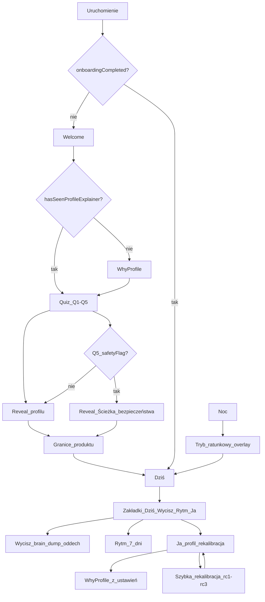
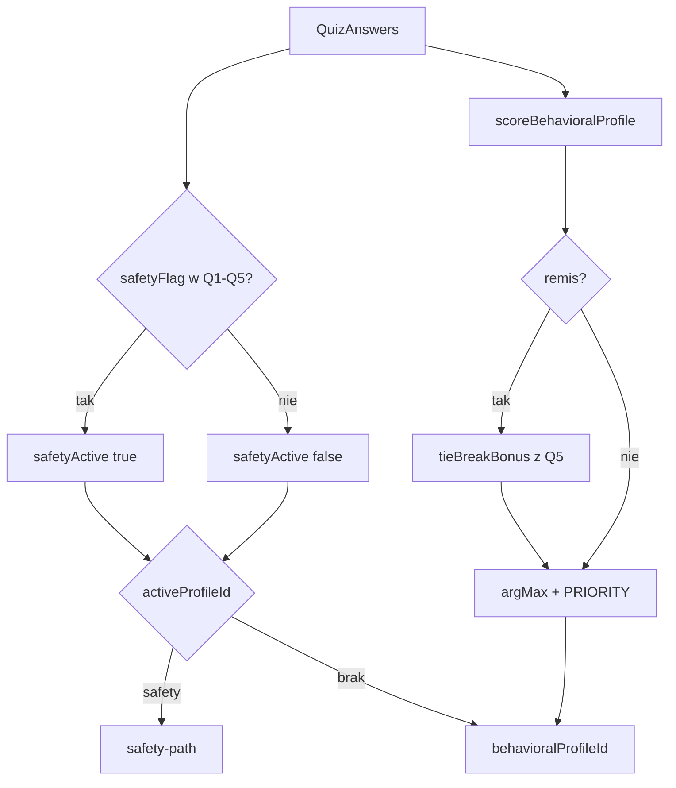
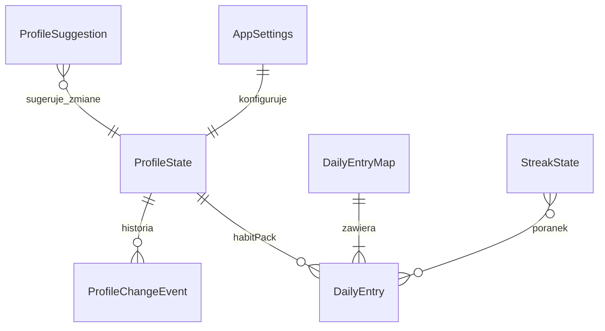

# Kotwica — projekt i architektura

**Wersja dokumentu:** 2.0  
**Status:** Specyfikacja zsynchronizowana z implementacją v2 w repozytorium  
**Stack:** React + TypeScript + Vite  
**Charakter produktu:** Przyjazny, lifestyle’owy trener nawyków snu — **nie** aplikacja kliniczna.

> **Uwaga dla zespołu:** Ten dokument opisuje stan **v2**. Kod w `src/` (m.in. `domain/quizMatrix.ts`, `ruleEngine.ts`, `WhyProfileScreen.tsx`, `types.ts` ze `schemaVersion: 2`) jest źródłem prawdy przy rozbieżnościach opis ↔ UI.

---

## Spis treści

1. [Delta v1 → v2 (checklist)](#1-delta-v1--v2-checklist)
2. [Założenia produktowe (skrót)](#2-założenia-produktowe-skrót)
3. [Przepływ użytkownika](#3-przepływ-użytkownika)
4. [Ekran WhyProfile — specyfikacja pełna](#4-ekran-whyprofile--specyfikacja-pełna)
5. [Profile behawioralne i ścieżka bezpieczeństwa](#5-profile-behawioralne-i-ścieżka-bezpieczeństwa)
6. [Detection & Recalibration Engine](#6-detection--recalibration-engine)
7. [Architektura UI](#7-architektura-ui)
8. [Mikrokopia (v2)](#8-mikrokopia-v2)
9. [Model danych localStorage — schema v2](#9-model-danych-localstorage--schema-v2)
10. [Struktura folderów i wdrożenie](#10-struktura-folderów-i-wdrożenie)
11. [Dostępność i motywy (bez zmian koncepcyjnych)](#11-dostępność-i-motywy-bez-zmian-koncepcyjnych)
12. [Słownik pojęć v2](#12-słownik-pojęć-v2)
13. [Historia zmian](#13-historia-zmian)

---

## 1. Delta v1 → v2 (checklist)

| Obszar | v1.0 | v2.0 | Stan w kodzie |
|--------|------|------|----------------|
| Liczba profili behawioralnych | 4 | **6** (+ `early-bird-flat`, `evening-wired`) | `behavioralProfiles.ts`, `habitPacks.ts` |
| Aktywny profil UI | `profileId` | `activeProfileId` + `behavioralProfileId` | `types.ts`, `profileResolve.ts` |
| Ścieżka bezpieczeństwa | Brak | `safety-path`, `safetyActive` z Q5 | `quizMatrix.ts`, `ruleEngine.ts` |
| Onboarding | Welcome → Quiz | Welcome → **WhyProfile** → Quiz → Reveal → Boundaries | `App.tsx`, `WhyProfileScreen.tsx` |
| Flaga wyjaśnienia | — | `hasSeenProfileExplainer` | `AppSettings`, `OnboardingWelcome.tsx` |
| Quiz Q1–Q5 | Inne pytania i macierz (4 kolumny) | **Nowe treści i wagi (6 kolumn)** | `quizMatrix.ts` |
| Tie-break | Tylko Q5 bonus | Jak v1, bonusy tylko na **behawioralnych** opcjach Q5 | `ruleEngine.ts` |
| Priorytet remisu | 4 profile | **6 profili** — kolejność `BEHAVIORAL_PRIORITY` | `behavioralProfiles.ts` |
| Rekalibracja | Brak | **rc1–rc3** w Ja | `recalibrationMatrix.ts`, `SettingsScreen.tsx` |
| Sugestia zmiany profilu | Brak | **R1–R5**, klucz `kotwica_v2_suggestion` | `suggestProfileShift.ts` |
| `profileSource` | `quiz` \| `manual` | + `recalibration` \| `suggested` | `types.ts` |
| Historia profilu | Brak | `profileHistory[]` | `ProfileState` |
| Schema | `schemaVersion: 1` | **`schemaVersion: 2`** + `migrate.ts` | `storage/migrate.ts` |
| `DailyEntry` | Kotwice | + **`rescueUsedAt[]`** (timestampy) | `types.ts` |
| Mikrokopia reveal | W dokumencie v1 | W **`profileMeta.ts`** (jedno źródło) | `profileMeta.ts` |
| Status dokumentu | Projekt przed kodem | **Zsynchronizowany z prototipem** | Ten plik |

---

## 2. Założenia produktowe (skrót)

Kotwica wspiera **małe kotwice** (poranek, wieczór), narzędzia wyciszenia i **tryb ratunkowy** — bez procentów snu, faz, diagnoz.

| Unikamy | Stosujemy |
|---------|-----------|
| Wyniki snu w %, etykiety kliniczne | Samopoczucie ikoną, rytm nawyków |
| Presja i „kara” za przerwę | Passa informacyjna, „witaj z powrotem” |
| Blokowanie aplikacji przy sygnałach medycznych | **Ścieżka bezpieczeństwa** — wspierający tryb + zachęta do specjalisty |

Dane: 100% `localStorage`, brak konta i backendu w prototypie.

---

## 3. Przepływ użytkownika

### 3.1 Diagram główny (onboarding v2)



### 3.2 Sekwencja onboardingu

| Krok | Route | Ekran | Rezultat w storage |
|------|-------|-------|-------------------|
| 1 | `/onboarding` | Welcome | — |
| 2 | `/onboarding/why-profile` | WhyProfile (opcjonalny skip) | `hasSeenProfileExplainer: true` |
| 3 | `/onboarding/quiz` | Quiz 1/5 … 5/5 | `quizAnswers` (partial → complete) |
| 4 | — | Reveal | `resolveProfileFromQuiz` → profil |
| 5 | — | Granice produktu | `onboardingCompleted: true` |
| 6 | `/today` | Dziś | `profileHistory`, kotwice domyślne z packa |

### 3.3 Pętle po onboardingu

| Pętla | Kiedy | Dane |
|-------|-------|------|
| Poranna kotwica | 04:00–14:00 (domyślnie) | `DailyEntry.morning`, `StreakState` |
| Wieczorne lądowanie | od ~17:00 | `DailyEntry.evening.stepsCompleted` |
| Rytm 7 dni | zakładka Rytm | pochodne z `DailyEntryMap` |
| Sugestia profilu | heurystyka 7 dni | `kotwica_v2_suggestion` |
| Rescue | noc, 1 tap | `DailyEntry.rescueUsedAt` |

### 3.4 Ja — rekalibracja i edukacja

```mermaid
flowchart LR
  me[Ja_/me] --> whyLink[Po_co_jest_profil]
  whyLink --> whyMe[/me/why-profile]
  me --> rc[Szybka_rekalibracja]
  rc --> merge[merge quizScores + rcScores]
  merge --> newProf[behavioralProfileId]
  newProf --> me
  me --> sugg[Karuzela_sugestii_R1-R5]
  sugg --> accept[acceptSuggestion]
  sugg --> dismiss[dismissSuggestion]
```

---

## 4. Ekran WhyProfile — specyfikacja pełna

**Plik referencyjny:** `src/features/onboarding/WhyProfileScreen.tsx`  
**Style:** `why-profile.css`, wspólne `Screen.css`  
**Tryby:** `onboarding` (domyślny), `from-settings` (link z Ja)

### 4.1 Routing i warunki wejścia

| Route | Warunek | Zachowanie |
|-------|---------|------------|
| `/onboarding/why-profile` | `!onboardingCompleted` | Pełny flow edukacyjny |
| `/me/why-profile` | zawsze (po onboardingu) | Brak quizu — powrót do Ja + link „Powtórz pełny quiz” |

**Welcome** (`OnboardingWelcome`): przycisk „Zaczynamy” → jeśli `hasSeenProfileExplainer` → `/onboarding/quiz`, w przeciwnym razie → `/onboarding/why-profile`.

### 4.2 Struktura treści (IA ekranu)

| Blok | Klasa / element | Treść (PL) | Cel UX |
|------|-----------------|------------|--------|
| Nagłówek | `screen__title` | „Każdy sen ma inny rytm” | Normalizacja różnic |
| Lead | `screen__subtitle` | Brak procentów; profil = 2–3 małe kroki | Oderwanie od trackera snu |
| Karta 1 | `card` + lista | Po co profil? (3 przykłady scenariuszy) | Kontrast trudności |
| Karta 2 | `card` | Czym profil **nie** jest (nie diagnoza, nie ranking) | Ograniczenie odpowiedzialności |
| Karta 3 | `card` | Jak to działa: quiz &lt; 30 s → nazwa → zmiana w Ja / sugestia 7 dni | Oczekiwania |
| Archetypy | `section` + poziomy scroll | 6 kart: nazwa + tagline z `BEHAVIORAL_META` | Transparentność **bez** ujawniania logiki wag |
| Bezpieczeństwo | `why-profile__safety` | Informacja o ścieżce bezpieczeństwa przy sygnałach medycznych | Zaufanie |
| CTA | `why-profile__cta` | Zależne od trybu (tabela 4.4) | Kontynuacja |

### 4.3 Karuzela archetypów

| Wymaganie | Wartość |
|-----------|---------|
| Źródło danych | `BEHAVIORAL_PROFILE_IDS.map` → `BEHAVIORAL_META[id]` |
| Układ | Poziomy scroll (`why-profile__scroll`), karty `why-profile__archetype` |
| a11y | `section aria-label="Archetypy snu"`, `role="list"` / `listitem` |
| Zakaz | Brak przycisku „wybierz ten profil” — tylko edukacja |

### 4.4 Akcje i nawigacja

| Tryb | Kontrolka | Akcja |
|------|-----------|--------|
| `onboarding` | „Zacznij krótki quiz” | `hasSeenProfileExplainer = true` → `navigate('/onboarding/quiz')` |
| `onboarding` | „Pomiń wyjaśnienie” (ghost) | Ta sama flaga → quiz |
| `from-settings` | „Wróć do Ja” | `navigate(-1)` |
| `from-settings` | Link „Powtórz pełny quiz” | `navigate('/onboarding')` (reset flagi onboardingu poza scope tego ekranu) |

### 4.5 Stany i reguły produktowe

- Ekran **nie** zapisuje profilu ani odpowiedzi quizu.
- Powtórne wejście po `hasSeenProfileExplainer === true` pomija WhyProfile w Welcome (użytkownik może wrócić z Ja).
- Ton: druga osoba, ciepło, bez rozkazów (spójnie z resztą aplikacji).

---

## 5. Profile behawioralne i ścieżka bezpieczeństwa

**Skróty wag w tabelach quizu:** NT, LS, EB, CO, WS, EW.

### 5.1 Tabela profili — tożsamość i nawyki

| ID | Nazwa PL | Fokus nawykowy | Narzędzia | Poranek (kroki) | Wieczór (kroki) | Domyślne czasy |
|----|----------|----------------|-----------|-----------------|-----------------|----------------|
| `night-thinker` | Nocny myśliciel | Odłożenie myśli, wyciszenie umysłu | brain-dump, breath | mood, wake-time | 3: zrzut, luźne myśli, ściemnienie | 07:30 / 22:30 |
| `light-sleeper` | Płytki sen | Spokojny powrót po wybudzeniu, stała pora | breath | mood, wake-time | 3: pora zaśnięcia, cisza, karta wybudzenia | 07:00 / 22:00 |
| `early-bird-flat` | Wczesny ptak bez baterii | Przesunięcie rytmu, światło po południu | breath | mood, wake-time, **morning-light** | 3: światło popoł., bez drzemek, opóźnienie snu | 06:30 / 22:00 |
| `city-owl` | Sowa w trybie miasta | Kotwica poranna + stopniowe cofanie wieczoru | brain-dump, breath | mood, wake-time, **morning-light** | 3: jasność, ostatni ekran, jutrzejsza pobudka | 08:30 / 23:00 |
| `weekend-shuttle` | Weekendowy wahadłowiec | Regularność PN–ND bez perfekcji | breath, brain-dump | mood, wake-time | 2 w tyg. / **3 w weekend** (wariant) | 08:00 / 22:30 |
| `evening-wired` | Przebodźcowany wieczorem | Kofeina, granica łóżka, oddech | brain-dump, breath | mood, wake-time | 3: okno bez kofeiny, łóżko bez ekranu, oddech | 07:30 / 23:00 |
| `safety-path` | Ścieżka bezpieczeństwa | Wsparcie bez presji; zachęta do specjalisty | breath | mood | 2: nota specjalisty, spokojny oddech | 07:30 / 22:30 |

### 5.2 Ścieżka bezpieczeństwa — zasady

| Aspekt | Zachowanie |
|--------|------------|
| Aktywacja | Dowolna opcja Q5 z `safetyFlag: true` w quizie |
| `activeProfileId` | Zawsze `'safety-path'` gdy `safetyActive` |
| `behavioralProfileId` | Nadal z macierzy wag (opcje safety **nie** dodają wag) |
| UI Reveal | Kicker: „Dbamy o bezpieczeństwo”; meta z `SAFETY_META` |
| Ja | Podpis: „Tryb wspierający — behawioralnie: {nazwa}” |
| Habit pack | `getHabitPack('safety-path')` — uproszczone kroki wieczorne |
| Blokada app | **Brak** — użytkownik ma dostęp do Wycisz i Rescue |

### 5.3 Opcje Q5 aktywujące safety

| ID opcji | Etykieta (skrót) |
|----------|------------------|
| `q5-safety-snoring` | Głośne chrapanie / podejrzenie przerw w oddychaniu |
| `q5-safety-driving` | Zasypianie za kierownicą lub w ciągu dnia |
| `q5-safety-legs` | Silna potrzeba ruszania nogami wieczorem / w łóżku |

---

## 6. Detection & Recalibration Engine

**Moduły:** `quizMatrix.ts`, `ruleEngine.ts`, `recalibrationMatrix.ts`, `suggestProfileShift.ts`, `profileResolve.ts`.

### 6.1 Algorytm quizu — kroki

1. `scores = zeroBehavioralScores()` dla 6 profili.
2. Dla każdego `q1…q5`: dodaj `option.weights`, **pomiń** gdy `safetyFlag`.
3. Jeśli remis (`isTied`) i jest `answers.q5`: dolicz `tieBreakBonus` z wybranej opcji Q5 (tylko behawioralne).
4. `behavioralProfileId = argMax(scores)` z tie-breakiem kolejności `BEHAVIORAL_PRIORITY`.
5. `safetyActive = detectSafetyFromAnswers(answers)`.
6. `activeProfileId = safetyActive ? 'safety-path' : behavioralProfileId`.

### 6.2 Macierz quizu — skala i legenda

| Symbol | Znaczenie |
|--------|-----------|
| 0–3 | Waga dopasowania (0 = brak wpływu w danym wierszu) |
| **TB** | Tie-break bonus (+2) przy remisie, tylko Q5 behawioralne |
| **SF** | `safetyFlag` — aktywuje ścieżkę, wagi behawioralne = 0 |

#### Q1 — ikona: księżyc

**„Co najbardziej opisuje wieczorne zasypianie?”**

| ID | Etykieta | NT | LS | EB | CO | WS | EW |
|----|--------|----|----|----|----|-----|-----|
| `q1-thoughts` | Gonitwa myśli — trudno „wyłączyć” głowę | 3 | 0 | 0 | 0 | 0 | 1 |
| `q1-long` | Długo zasypiam, ale potem śpię do rana | 2 | 0 | 0 | 0 | 1 | 2 |
| `q1-wake` | Budzę się w nocy i trudno znów usnąć | 0 | 3 | 0 | 0 | 1 | 0 |
| `q1-late` | Zasypiam bardzo późno, choć jestem zmęczony/a | 0 | 0 | 0 | 3 | 0 | 2 |
| `q1-varies` | Zależy od dnia | 0 | 0 | 0 | 1 | 3 | 0 |

#### Q2 — ikona: noc

**„Co dzieje się w środku nocy?”**

| ID | Etykieta | NT | LS | EB | CO | WS | EW |
|----|--------|----|----|----|----|-----|-----|
| `q2-clock` | Budzę się i sprawdzam godzinę | 1 | 3 | 0 | 0 | 0 | 0 |
| `q2-early` | Budzę się za wcześnie i nie mogę już spać | 0 | 1 | 3 | 0 | 0 | 0 |
| `q2-brief` | Krótko się budzę, potem znów śpię | 1 | 2 | 0 | 0 | 0 | 0 |
| `q2-rare` | Rzadko się budzę | 0 | 0 | 0 | 1 | 0 | 1 |
| `q2-weekend` | Inaczej w tygodniu niż w weekend | 0 | 0 | 0 | 0 | 3 | 0 |

#### Q3 — ikona: wschód słońca

**„Poranek bez budzika wyglądałby tak…”**

| ID | Etykieta | NT | LS | EB | CO | WS | EW |
|----|--------|----|----|----|----|-----|-----|
| `q3-early` | Ok. 5:00–6:30 | 0 | 0 | 3 | 0 | 0 | 0 |
| `q3-mid` | Ok. 7:00–8:30 | 1 | 1 | 0 | 0 | 1 | 0 |
| `q3-late` | Po 9:00 | 0 | 0 | 0 | 3 | 0 | 1 |
| `q3-shift` | Mocno się przesuwa | 0 | 0 | 0 | 0 | 2 | 2 |

#### Q4 — ikona: rytm

**„Co najbardziej psuje Twój rytm?”**

| ID | Etykieta | NT | LS | EB | CO | WS | EW |
|----|--------|----|----|----|----|-----|-----|
| `q4-mind` | Myśli wieczorem | 3 | 0 | 0 | 0 | 0 | 0 |
| `q4-fragments` | Częste budzenia | 0 | 3 | 0 | 0 | 0 | 0 |
| `q4-early` | Zbyt wczesne pobudki | 0 | 0 | 3 | 0 | 0 | 0 |
| `q4-late` | Późne wieczory w mieście / praca | 0 | 0 | 0 | 3 | 0 | 0 |
| `q4-weekend` | Weekendowy zjazd | 0 | 0 | 0 | 0 | 3 | 0 |
| `q4-wired` | Kofeina lub ekran w łóżku | 0 | 0 | 0 | 0 | 0 | 3 |

#### Q5 — ikona: serce

**„Co najbardziej dotyka Twojego snu ostatnio?”**

| ID | Etykieta | NT | LS | EB | CO | WS | EW | TB | SF |
|----|--------|----|----|----|----|-----|-----|----|----|
| `q5-thoughts` | Myśli, które nie chcą ucichnąć | 3 | 0 | 0 | 0 | 0 | 0 | +2 NT | |
| `q5-fragments` | Częste budzenia w nocy | 0 | 3 | 0 | 0 | 0 | 0 | +2 LS | |
| `q5-early` | Wczesne pobudki bez energii | 0 | 0 | 3 | 0 | 0 | 0 | +2 EB | |
| `q5-schedule` | Późny rytm / zmęczenie rano | 0 | 0 | 0 | 3 | 0 | 0 | +2 CO | |
| `q5-social` | Nieregularny rytm tygodnia i weekendu | 0 | 0 | 0 | 0 | 3 | 0 | +2 WS | |
| `q5-stim` | Pobudzenie wieczorem (kofeina, ekran) | 0 | 0 | 0 | 0 | 0 | 3 | +2 EW | |
| `q5-safety-snoring` | Głośne chrapanie / przerwy w oddychaniu | 0 | 0 | 0 | 0 | 0 | 0 | — | **SF** |
| `q5-safety-driving` | Zasypianie za kierownicą / w dzień | 0 | 0 | 0 | 0 | 0 | 0 | — | **SF** |
| `q5-safety-legs` | Ruszanie nogami wieczorem / w łóżku | 0 | 0 | 0 | 0 | 0 | 0 | — | **SF** |

**Priorytet remisu (kolejność `BEHAVIORAL_PRIORITY`):**  
`night-thinker` → `light-sleeper` → `early-bird-flat` → `city-owl` → `weekend-shuttle` → `evening-wired`.

### 6.3 Rekalibracja rc1–rc3

Wynik: `mergeScores(scoreBehavioralProfile(quizAnswers), scoreRecalibration(rcAnswers))` → `argMax`.

#### rc1 — „Różnica pobudek: tydzień vs weekend”

| ID | Etykieta | WS | CO | inne |
|----|--------|----|----|------|
| `rc1-same` | Podobnie | — | — | — |
| `rc1-mid` | Ok. 30–60 min | 1 | — | — |
| `rc1-big` | Więcej niż 60 min | 3 | — | — |
| `rc1-late` | Weekend bardzo późno | 2 | 1 | — |

#### rc2 — „Główna trudność z ostatnich 7 dni”

| ID | Etykieta | Profil +2 |
|----|--------|-----------|
| `rc2-thoughts` | Myśli wieczorem | NT |
| `rc2-wake` | Budzenia w nocy | LS |
| `rc2-early` | Za wczesne wstawanie | EB |
| `rc2-late` | Późny rytm | CO |
| `rc2-weekend` | Rozjazd weekend | WS |
| `rc2-wired` | Pobudzenie wieczorem | EW |

#### rc3 — „Kofeina / ekran w łóżku po 20:00”

| ID | Etykieta | EW | NT |
|----|--------|----|-----|
| `rc3-yes` | Tak | 3 | — |
| `rc3-sometimes` | Czasem | 1 | 1 |
| `rc3-no` | Nie | — | — |

**Wymaganie UI:** wszystkie trzy odpowiedzi wypełnione przed „Przelicz profil”.  
**Źródło:** `profileSource: 'recalibration'`, wpis w `profileHistory`.

### 6.4 Reguły sugestii R1–R5 (ostatnie 7 dni)

Dane: `DailyEntryMap`, bieżący `behavioralProfileId`. Zapis: `ProfileSuggestion` pod kluczem `kotwica_v2_suggestion`.

| Kod | Etykieta UI (`reasonLabel`) | Warunek (implementacja / plan) | Sugerowany profil |
|-----|----------------------------|--------------------------------|-------------------|
| **R1** | Rytm weekendowy | ≥2 pobudki PN–PT i ≥2 weekendowych; średnia weekend − weekday ≥ **90 min**; profil ≠ WS | `weekend-shuttle` |
| **R2** | Nocne wybudzenia | ≥**3** użycia Rescue między 01:00–04:00 (`rescueUsedAt`); profil ≠ LS | `light-sleeper` |
| **R3** | Wczesne pobudki | ≥**4** dni z pobudką &lt; 05:30; profil ≠ EB | `early-bird-flat` |
| **R4** | Późne wieczory | *Zarezerwowane w typach* — plan: średnia `windDownTime` po 23:00 lub spóźnione wieczorne kotwice ≥5/7 dni; profil ≠ CO | `city-owl` |
| **R5** | Wieczorne pobudzenie | ≥**4** dni `mood === 'rough'`; profil ≠ EW | `evening-wired` |

Akceptacja: `acceptSuggestion` → `profileSource: 'suggested'`. Odrzucenie: `dismissedUntil` (cooldown).

### 6.5 Pseudokod — `resolveProfileFromQuiz`

```typescript
function resolveProfileFromQuiz(answers: QuizAnswers): ResolvedProfile {
  const safetyActive = detectSafetyFromAnswers(answers);
  const scores = scoreBehavioralProfile(answers);
  const behavioralProfileId = argMaxWithPriority(scores, BEHAVIORAL_PRIORITY);
  const activeProfileId = safetyActive ? 'safety-path' : behavioralProfileId;
  return { behavioralProfileId, safetyActive, activeProfileId };
}

function scoreBehavioralProfile(answers: QuizAnswers): Scores {
  const scores = zeroBehavioralScores();
  for (const question of QUIZ_QUESTIONS) {
    const option = getQuizOption(question.id, answers[question.id]);
    if (option && !option.safetyFlag) addWeights(scores, option.weights);
  }
  if (isTied(scores) && answers.q5) {
    const q5 = getQuizOption('q5', answers.q5);
    if (q5?.tieBreakBonus) addPartialWeights(scores, q5.tieBreakBonus);
  }
  return scores;
}

function detectSafetyFromAnswers(answers: QuizAnswers): boolean {
  for (const question of QUIZ_QUESTIONS) {
    const option = getQuizOption(question.id, answers[question.id]);
    if (option?.safetyFlag) return true;
  }
  return false;
}
```

### 6.6 Diagram silnika decyzji



---

## 7. Architektura UI

### 7.1 Nawigacja i trasy

| Warstwa | Ścieżki | Uwagi |
|---------|---------|-------|
| Onboarding (bez tab bara) | `/onboarding`, `/onboarding/why-profile`, `/onboarding/quiz` | Redirect jeśli `onboardingCompleted` |
| Główna (tab bar) | `/today`, `/calm`, `/calm/brain-dump`, `/calm/breath`, `/rhythm`, `/me` | `MainLayout` + `TabBar` |
| Overlay globalny | Rescue (`RescueProvider`) | Ponad tab bar, `data-time-of-day=rescue` |
| Edukacja z Ja | `/me/why-profile` | Bez onboarding guard |

### 7.2 Zakładka Ja (`/me`) — sekcje v2

| Sekcja | Funkcja |
|--------|---------|
| Sugestia rytmu | Karta R1–R5, akceptacja / „Nie teraz” |
| Twój profil snu | Nazwa aktywna, link „Po co jest profil snu?”, select testowy, powtórny quiz |
| Szybka rekalibracja | rc1–rc3 + „Przelicz profil” |
| Kotwice czasowe | `anchorTimes.wakeTime`, `windDownTime` |
| Dźwięk / wibracja / wygląd | Rama telefonu, override pory dnia |
| Granice produktu | Treść prawna-lite |
| Zaawansowane | Reset, seed demo |

### 7.3 Mobile-first

| Element | Spec |
|---------|------|
| `PhoneFrame` | max ~430px, opcjonalnie na desktopie (`phoneFrameEnabled`) |
| Touch targets | min. 44px; Rescue min. 72px |
| Motywy | `data-time-of-day` na `<html>`: morning / day / evening / night / rescue |
| Tokeny kolorów | `tokens.css`, `themes.css` — bez czystej #FFF/#000 na tekście |

### 7.4 Stany onboardingu w jednym komponencie

`OnboardingQuiz`: `quiz` → `reveal` → `boundaries` (bez osobnych plików ekranów).

---

## 8. Mikrokopia (v2)

Źródło reveal i starterów: `profileMeta.ts`. Wieczór: `habitPacks.ts`.

### 8.1 Reveal (onboarding) + startery

| Profil | Reveal (`onboardingRevealPl`) | Startery (`starterHabitsPl`) |
|--------|-------------------------------|------------------------------|
| NT | Wieczorem Twój umysł jeszcze pracuje. Zaczniemy od zrzutu głowy, strefy bez ekranów i spokojnego oddechu. | Zrzut głowy wieczorem; Ściemnienie ekranu; 3 min oddechu |
| LS | Często budzisz się w nocy. Priorytetem będzie łagodny powrót do snu — bez oceniania i bez statystyk w nocy. | Tryb ratunkowy pod ręką; Zasada 20 minut; Stała pora zaśnięcia |
| EB | Rano wstajesz zanim ciało jest gotowe. Skupimy się na świetle po południu i małych krokach bez drzemek „na szybko”. | Światło po południu; Bez drzemek w dzień; Delikatne opóźnienie snu |
| CO | Energia przychodzi wieczorem. Poranna kotwica ze światłem i stopniowe przesuwanie wieczoru o 15 minut to dobry start. | Poranne światło; Wieczór −15 min / tydzień; Stała pobudka |
| WS | Rytm skacze między tygodniem a weekendem. Stabilizujemy pobudkę w weekendy — maksymalnie ok. 45 min później niż w tygodniu. | Kotwica weekendu; Łagodne lądowanie w piątek; Krótka kotwica w niedzielę |
| EW | Scroll, kofeina lub praca w łóżku trzyma Cię w pobudzeniu. Zaczniemy od okna bez kofeiny i jasnej granicy łóżka. | Okno bez kofeiny; Łóżko bez ekranu; Krótki oddech przed snem |
| safety | Kotwica nie zastępuje lekarza. Poniżej spokojna wskazówka — możesz korzystać z narzędzi wyciszenia bez „ograniczania snu”. | Spokojny oddech; Kontakt ze specjalistą — gdy będziesz gotowy/a; Tryb wspierający bez zegara |

### 8.2 Wieczorne lądowanie — 3 kroki (kroki tygodnia; WS w weekendzie ma wariant)

| Profil | Krok 1 | Krok 2 | Krok 3 |
|--------|--------|--------|--------|
| NT | Zrzut głowy — odłóż myśli (deep link) | Luźne myśli — 5 min poza ekranem | Ściemnij ekran |
| LS | Stała pora zaśnięcia | Cisza / tryb cichy wieczór | Gdy się obudzisz — krótka rutyna |
| EB | Światło po południu (12–16) | Bez drzemek w dzień | Delikatne opóźnienie snu (+15 min) |
| CO | Jasność wieczorem | Ostatni ekran — symboliczna kotwica | Jutrzejsza pobudka (±15 min OK) |
| WS (PN–CZ) | Jedna godzina „ciemno” w tygodniu | Krótki oddech 2 min (deep link) | — |
| WS (PT–ND) | Kotwica weekendu | Zrzut głowy (deep link) | Niedzielna kotwica poranna |
| EW | Okno bez kofeiny po 14:00 | Łóżko bez ekranu | Oddech przed snem (deep link) |
| safety | Warto porozmawiać ze specjalistą | Spokojny oddech (opcjonalnie) | — |

### 8.3 Tagline (karty WhyProfile i Ja)

| Profil | Tagline |
|--------|---------|
| NT | Twój umysł lubi kończyć rozmowy — pomożemy je odłożyć na jutro. |
| LS | Budujemy spokojne noce — z trybem 1 dotknięciem i bez patrzenia na zegar. |
| EB | Budzisz się za wcześnie — łagodnie przesuniemy rytm, bez walki z porankiem. |
| CO | Twój rytm jest późny — kotwiczymy dzień tak, jak pozwala miasto. |
| WS | Tydzień i weekend to dwa światy — liczy się mała regularność, nie perfekcja. |
| EW | Wieczorem ciało jest „włączone” — oddzielamy łóżko od ekranów i kofeiny. |
| safety | Twoje odpowiedzi wskazują, że warto porozmawiać ze specjalistą — aplikacja zostaje wspierająca, bez presji. |

### 8.4 Komunikaty sugestii (przykłady z kodu)

| Kod | `messagePl` (skrót) |
|-----|---------------------|
| R1 | Różnica pobudek w weekendy… profil „Weekendowy wahadłowiec” |
| R2 | Kilka razy w nocy sięgałeś/aś po tryb ratunkowy… „Płytki sen” |
| R3 | Często wstajesz bardzo wcześnie… „Wczesny ptak bez baterii” |
| R5 | Ostatnie dni były ciężkie wieczorem… „Przebodźcowany wieczorem” |

---

## 9. Model danych localStorage — schema v2

### 9.1 Konwencje

| Reguła | Wartość |
|--------|---------|
| Prefiks kluczy | Nadal `kotwica_v1_*` dla większości (kompatybilność); **nowy:** `kotwica_v2_suggestion` |
| Serializacja | JSON |
| `schemaVersion` | **2** w głównych obiektach po migracji |
| Migracja | `storage/migrate.ts` przy hydratacji |

### 9.2 Klucze

| Klucz | Typ | Opis |
|-------|-----|------|
| `kotwica_v1_settings` | `AppSettings` | + `hasSeenProfileExplainer` |
| `kotwica_v1_profile` | `ProfileState` | v2 pola behawioralne |
| `kotwica_v1_daily` | `DailyEntryMap` | + `rescueUsedAt` |
| `kotwica_v1_brain_dumps` | `BrainDumpEntry[]` | bez zmian strukturalnych |
| `kotwica_v1_streak` | `StreakState` | bez zmian |
| `kotwica_v1_meta` | `StorageMeta` | `schemaVersion: 2` |
| `kotwica_v2_suggestion` | `ProfileSuggestion` | Aktywna sugestia R* |

### 9.3 Typy TypeScript (rdzeń v2)

```typescript
type SchemaVersion = 1 | 2;

type BehavioralProfileId =
  | 'night-thinker'
  | 'light-sleeper'
  | 'early-bird-flat'
  | 'city-owl'
  | 'weekend-shuttle'
  | 'evening-wired';

type ActiveProfileId = BehavioralProfileId | 'safety-path';

type ProfileSource = 'quiz' | 'manual' | 'recalibration' | 'suggested';

type SuggestionReasonCode = 'R1' | 'R2' | 'R3' | 'R4' | 'R5';

interface AppSettings {
  schemaVersion: SchemaVersion;
  onboardingCompleted: boolean;
  hasSeenProfileExplainer: boolean;
  locale: 'pl';
  phoneFrameEnabled: boolean;
  timeOfDayOverride?: TimeOfDay | null;
  anchorTimes: AnchorTimes;
  audio: { breathSoundEnabled: boolean; rescueSoundEnabled: boolean; volume: number };
  haptics: { breathPulseEnabled: boolean };
  developer: { seedDemoOnFirstRun: boolean; showDebugPanel: boolean };
}

interface ProfileState {
  schemaVersion: SchemaVersion;
  activeProfileId: ActiveProfileId;
  behavioralProfileId: BehavioralProfileId;
  safetyActive: boolean;
  profileSource: ProfileSource;
  quizAnswers?: QuizAnswers;
  recalibrationAnswers?: RecalibrationAnswers;
  lastRecalibratedAt?: string;
  profileAssignedAt: string;
  profileHistory: ProfileChangeEvent[];
  displayName?: string;
  /** @deprecated v1 — migracja z profileId */
  profileId?: ActiveProfileId;
}

interface ProfileSuggestion {
  schemaVersion: SchemaVersion;
  suggestedProfileId: BehavioralProfileId;
  reasonCode: SuggestionReasonCode;
  messagePl: string;
  createdAt: string;
  dismissedUntil?: string;
}

interface DailyEntry {
  schemaVersion: SchemaVersion;
  date: string;
  morning?: {
    mood?: MoodIcon;
    wakeTimeConfirmed?: string;
    morningLightDone?: boolean;
    completedAt?: string;
  };
  evening?: { stepsCompleted: string[]; completedAt?: string };
  anchorsDone: { morning: boolean; evening: boolean };
  /** ISO timestampy użyć Rescue — feed dla R2 */
  rescueUsedAt?: string[];
}

interface ProfileChangeEvent {
  at: string;
  from: ActiveProfileId;
  to: ActiveProfileId;
  source: ProfileSource;
}

interface ResolvedProfile {
  behavioralProfileId: BehavioralProfileId;
  safetyActive: boolean;
  activeProfileId: ActiveProfileId;
}
```

### 9.4 Migracja v1 → v2 (profil)

| Pole v1 | Pole v2 |
|---------|---------|
| `profileId` | `activeProfileId` + `behavioralProfileId` |
| brak | `safetyActive` (true jeśli legacy `safety-path`) |
| brak | `profileHistory: []` domyślnie |

### 9.5 Diagram relacji



---

## 10. Struktura folderów i wdrożenie

### 10.1 Struktura repozytorium (aktualna v2)

```text
SleepDisorder/
├── DESIGN_AND_ARCHITECTURE.md
├── README.md
├── package.json
├── vite.config.ts
├── index.html
├── public/
└── src/
    ├── main.tsx
    ├── app/
    │   ├── App.tsx
    │   ├── app.css
    │   ├── layouts/MainLayout.tsx
    │   └── providers/
    │       ├── ThemeProvider.tsx
    │       ├── StorageProvider.tsx
    │       └── RescueProvider.tsx
    ├── components/
    │   ├── PhoneFrame.tsx
    │   ├── TabBar.tsx
    │   ├── MoodPicker.tsx
    │   ├── ChecklistStep.tsx
    │   └── Button.tsx
    ├── features/
    │   ├── onboarding/
    │   │   ├── OnboardingWelcome.tsx
    │   │   ├── WhyProfileScreen.tsx
    │   │   ├── OnboardingQuiz.tsx
    │   │   ├── onboarding.css
    │   │   └── why-profile.css
    │   ├── today/TodayScreen.tsx
    │   ├── calm/
    │   ├── rescue/RescueOverlay.tsx
    │   ├── rhythm/RhythmScreen.tsx
    │   └── settings/SettingsScreen.tsx
    ├── domain/
    │   ├── types.ts
    │   ├── behavioralProfiles.ts
    │   ├── profileMeta.ts
    │   ├── quizMatrix.ts
    │   ├── recalibrationMatrix.ts
    │   ├── ruleEngine.ts
    │   ├── profileResolve.ts
    │   ├── suggestProfileShift.ts
    │   ├── habitPacks.ts
    │   ├── streak.ts
    │   └── sevenDayView.ts
    ├── storage/
    │   ├── keys.ts
    │   ├── persist.ts
    │   ├── defaults.ts
    │   ├── migrate.ts
    │   └── seedDemo.ts
    ├── styles/
    └── utils/
```

### 10.2 Plan wdrożenia w 4 krokach (v2 — stan docelowy)

#### Krok 1 — Szkielet i motywy

- Vite + React + TS, `PhoneFrame`, `ThemeProvider`, routing podstawowy.
- **DoD:** motywy pory dnia, tab bar placeholder.

#### Krok 2 — Onboarding v2 i silnik profili

- `WhyProfileScreen`, quiz Q1–Q5, `resolveProfileFromQuiz`, safety path.
- Typy v2, `migrate.ts`, hydratacja `StorageProvider`.
- **DoD:** powtarzalny wynik quizu; migracja ze starym `profileId`.

#### Krok 3 — Pętla Dziś, Rytm, Ja

- `getHabitPack` dla 6 profili + safety, `rescueUsedAt`, rekalibracja rc1–rc3.
- Sugestie R1–R5 (klucz v2), karta w Ja.
- **DoD:** 7 dni na Rytm bez procentów; sugestia po seed demo.

#### Krok 4 — Wycisz i Rescue

- Brain dump, oddech, overlay Rescue, haptics/audio.
- **DoD:** Rescue jednym tapnięciem w nocy; pełna ścieżka onboarding → Dziś.

### 10.3 Uruchomienie lokalne

```bash
cd SleepDisorder
npm install
npm run dev
```

Domyślnie: `http://localhost:5173`.

---

## 11. Dostępność i motywy (bez zmian koncepcyjnych)

| Temat | Wytyczna |
|-------|----------|
| Kontrast | AA w night/rescue |
| Rescue | `aria-modal`, brak zegara, duży CTA |
| Oddech | `aria-live="polite"` na fazach |
| Motion | `prefers-reduced-motion` wyłącza pulsację |
| Audio | Start po geście użytkownika (`AudioContext.resume`) |

Tokeny kolorów `morning | day | evening | night | rescue` — jak w v1.0 (sekcja 3.5 dokumentu poprzedniego); implementacja w `themes.css`.

---

## 12. Słownik pojęć v2

| Termin | Znaczenie |
|--------|-----------|
| Profil behawioralny | Jedna z 6 archetypów UX — wzorzec zachowania, nie diagnoza |
| `activeProfileId` | To, co napędza habit pack (w tym `safety-path`) |
| `behavioralProfileId` | Wynik quizu / rekalibracji bez warstwy safety |
| WhyProfile | Edukacja przed quizem |
| Rekalibracja | Krótki przegląd rc1–rc3 nałożony na wagi quizu |
| Sugestia R* | Heurystyka 7 dni — propozycja zmiany profilu |
| Rescue | Tryb ratunkowy — bez statystyk i tab bara |

---

## 13. Historia zmian

| Wersja | Data | Opis |
|--------|------|------|
| 1.0 | 2025-11-25 | Specyfikacja projektu: 4 profile, quiz v1, model danych v1, plan przed implementacją |
| **2.0** | **2025-11-25** | **6 profili behawioralnych + ścieżka bezpieczeństwa; WhyProfile; nowy quiz i macierze wag; rekalibracja rc1–rc3; sugestie R1–R5; schema v2 (`ProfileState`, `ProfileSuggestion`, `rescueUsedAt`, `hasSeenProfileExplainer`); dokument zsynchronizowany z kodem prototypu** |

---

*Kolejne wersje dokumentu: bump `schemaVersion` lub sekcji Rule Engine przy każdej zmianie macierzy wag lub reguł R*.*